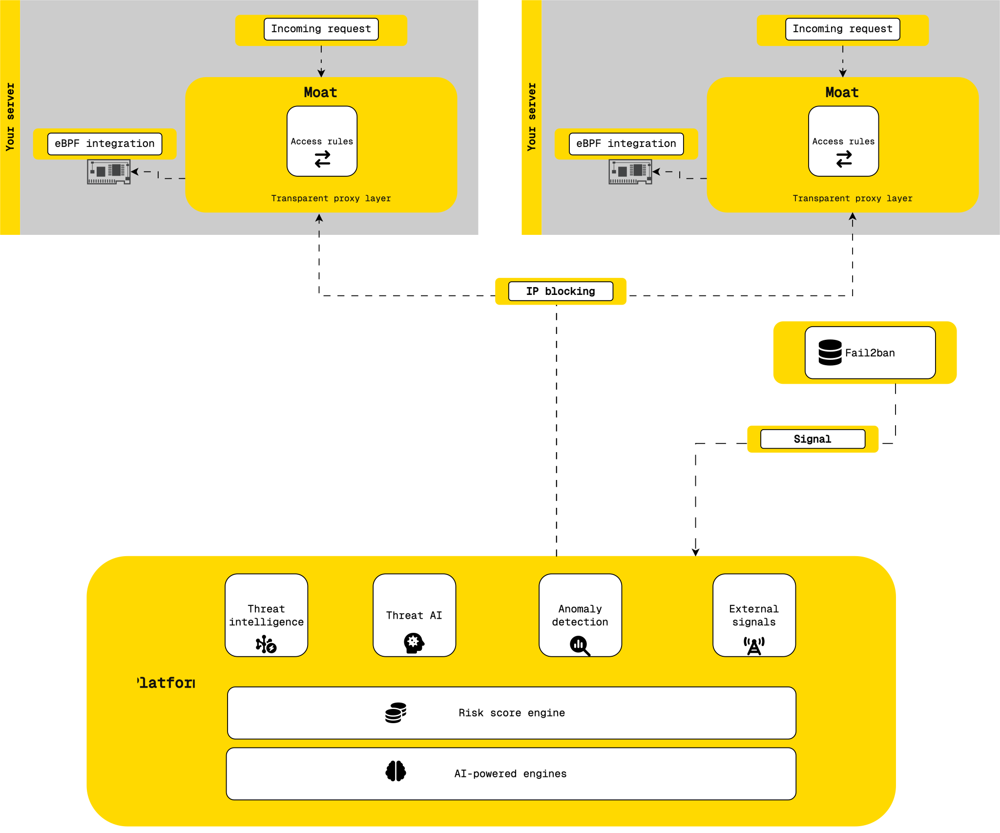

# Fail2Ban

A Fail2Ban action that reports banned IP addresses to the Gen0Sec Signal API (`POST /v2/signal`).
The request format is described in the [Signal API v2 reference](https://docs.gen0sec.com/docs/api/signal-api#signal-api-v2).

## Flow diagram


## Fail2Ban Integration

The `integrations/fail2ban/` directory contains a Fail2Ban action file that integrates with the Gen0Sec API to automatically block malicious IP addresses.

### Setup

1. Copy the action file to your Fail2Ban actions directory:

   ```bash
   curl -fSL https://raw.githubusercontent.com/gen0sec/example/refs/heads/main/integrations/fail2ban/gen0sec.conf -o /etc/fail2ban/action.d/gen0sec.conf
   ```

2. Put your Gen0Sec API key in a header file that only root can read:
   ```bash
   sudo install -m 600 -o root -g root /dev/null /etc/fail2ban/gen0sec.headers
   echo 'Authorization: Bearer YOUR_API_KEY' | sudo tee /etc/fail2ban/gen0sec.headers >/dev/null
   ```
   The action passes this file to curl, so the key never appears in the command
   that Fail2Ban runs and logs. To use another path, set `g0sheaders` in the
   `[Init]` section.

3. If you used the earlier version of this action, remove the `g0stoken` line you
   set in `gen0sec.conf` or `jail.local`; it is no longer read.

4. Configure your jail to use the Gen0Sec action by editing your jail configuration:
   ```bash
   sudo nano /etc/fail2ban/jail.conf
   ```

   Add or modify the action parameter:
   ```
      banaction = gen0sec
      banaction_allports = gen0sec
   ```

   **Debian** related system. E.g: Ubuntu, Debian. `/etc/fail2ban/jail.d/defaults-debian.conf`
   ```
   [DEFAULT]
   banaction = gen0sec
   banaction_allports = gen0sec
   backend = systemd

   [sshd]
   enabled = true
   ```

### Requirements

- `curl` 7.55 or later (required; it reads the API key header from a file)
- `jq` (optional, for JSON parsing)
- Gen0Sec API token with the `signal:write` permission (available from your Gen0Sec dashboard)

**Upgrading from the earlier action:** it used the v1 Signal API, which needed no particular permission. Check that your key has the `signal:write` permission before you replace the file; without it every ban is refused, and Fail2Ban logs `Error banning`.

### Configuration Options

- `g0sheaders`: File holding the `Authorization: Bearer <key>` header (default: `/etc/fail2ban/gen0sec.headers`, mode 0600)
- `g0shost`: This host's part of the rule name (default: the short hostname)
- `expiration`: Block expiration time in seconds (default: the jail's `bantime`)

A ban, unban or prolong that the API does not accept with HTTP 200 fails, and Fail2Ban logs it as an error. That covers a key without the permission, an entry the API rejects, and an unreachable API.

When an IP is banned, the action creates a Gen0Sec access rule that blocks it, named `fail2ban-<host>-<jail>-<ip>`. When Fail2Ban unbans the IP, the action deletes that rule. Each host has its own rule, so one host's unban does not lift a block another host still holds. The host part is the short hostname; set `g0shost` if two hosts share one.

A rule name is at most 128 characters of letters, digits, `.`, `_`, `:` and `-`. A jail or host name with other characters, or a long one combined with an IPv6 address, makes the API reject the ban, and Fail2Ban logs the error.

Expiration is handled by the API as follows:

- The rule expires after `expiration` seconds, so Gen0Sec lifts the block on its own even if the unban never reaches the API.
- A value below 60 is raised to 60, and 0 means one day.
- A negative value is rejected, so a jail with a permanent ban (`bantime = -1`) needs `expiration` set to a positive number.

### Testing the action

`test/test_action.py` renders the action with Fail2Ban's own code and runs it against a local mock of the Signal API. It checks that a ban, unban or prolong succeeds only when the API answers 200. It needs the Fail2Ban Python package and sends nothing to Gen0Sec:

```bash
python3 test/test_action.py
```

### Ansible

To roll the action out with Ansible, use the `fail2ban` role in
[gen0sec/ansible-playbook](https://github.com/gen0sec/ansible-playbook/tree/main/roles/fail2ban).
It installs this same `gen0sec.conf`, writes the API key to
`/etc/fail2ban/gen0sec.headers` (mode 0600) and wires the jails. Its README
lists the variables (`fail2ban_enabled`, `gen0sec_api_key`,
`gen0sec_expiration`, `fail2ban_host`) and shows how to include the role.

Coming from the playbook that used to live here: rename `gen0sec_api_token`
to `gen0sec_api_key` and set `fail2ban_enabled: true`, or the role does
nothing. `gen0sec_expiration` now defaults to the jail's `bantime` instead of
600 seconds; set it to keep 600.
